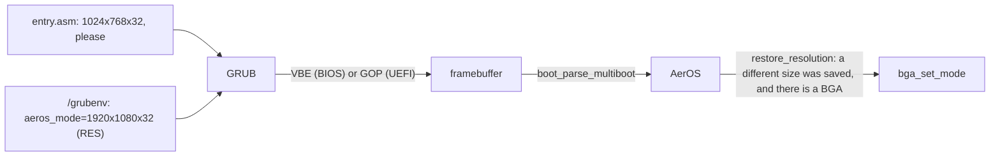

# The screen

AerOS draws everything, the terminal included, into a framebuffer: one block of memory with a
32 bit number for each pixel. This document explains how the screen gets its size, how `RES`
changes it, and which graphics cards (real, QEMU and VirtualBox) can do what.

| File | What it does |
| --- | --- |
| [`src/entry.asm`](../src/entry.asm) | the multiboot header, which asks GRUB for 1024 x 768 at 32 bits a pixel |
| [`src/iso/boot/grub/grub.cfg`](../src/iso/boot/grub/grub.cfg), [`src/install/grub.cfg`](../src/install/grub.cfg) | GRUB's menu on the CD and on an installed disk: reads the size `RES` saved |
| [`src/sys/boot.c`](../src/sys/boot.c) | `boot_parse_multiboot` reads the framebuffer GRUB set up; `restore_resolution` puts back a saved size GRUB couldn't |
| [`src/drivers/video/VGA_linear.c`](../src/drivers/video/VGA_linear.c) | the console on the framebuffer (or in VGA text mode, if there is none) |
| [`src/drivers/video/bga.c`](../src/drivers/video/bga.c) | changing the size while AerOS runs, on the Bochs Graphics Adapter |
| [`src/sys/terminal/cmd_system.c`](../src/sys/terminal/cmd_system.c) | the `RES` command |

## How the screen gets its size

1. GRUB reads the size saved with `RES` from `/grubenv` on the AEROS disk (`load_env`), and
   asks the firmware for that mode, then for 1024x768x32, then for anything (`auto`):
   `set gfxpayload="$aeros_mode,1024x768x32,auto"`. With nothing saved it asks for what the
   multiboot header says, 1024x768x32.
2. The firmware sets the mode: VBE on a BIOS PC, GOP on a UEFI one. Both only know a fixed list
   of sizes, which depends on the graphics card.
3. GRUB tells AerOS where the framebuffer is and how big (`boot_parse_multiboot`), and the
   console is drawn on it.
4. Once the disk is mounted, `restore_resolution` looks at `/grubenv` again. If the screen
   isn't the saved size (the firmware didn't have it) and the card is a Bochs Graphics Adapter,
   which can do any size its memory holds, AerOS changes to it itself. The boot log says
   `Screen: 1920x1080, the size saved with RES (the firmware started at 1024x768)`.

Without the fallback in step 1, a saved size the firmware didn't know left GRUB in **text
mode**: AerOS then started in 80 x 25 characters, with no way to change back from there. That
is what VirtualBox did with any `RES` size other than 1024 x 768 (see below).

## RES

| Command | Does |
| --- | --- |
| `RES` | says the size now, and some common ones |
| `RES 1920x1080` | changes it now, if the card is a BGA, and saves it in `/grubenv` for the next start (needs an AEROS disk) |

`/grubenv` is a GRUB environment block: exactly 1024 bytes, a fixed first line, `name=value`
lines, and `#` to fill the rest. `save_resolution` in `cmd_system.c` writes it.

## Graphics cards

| Card | At boot (firmware) | `RES` while running |
| --- | --- | --- |
| QEMU `-vga std` (the default) | VBE, a long list of sizes | yes (BGA) |
| VirtualBox **VBoxVGA** | VBE, a short list: no 1280x720, 1600x900 or 1920x1080 | yes (BGA) |
| VirtualBox **VMSVGA** | the same VBE list | yes (it still has the BGA's ports) |
| VirtualBox **VBoxSVGA** | the same VBE list | yes |
| a real PC | VBE or GOP, whatever the card offers | no: the size is fixed until the next start |

On a real PC `RES` only saves the size, and it takes effect at the next start if the card's
firmware has it (otherwise GRUB falls back to 1024 x 768, then anything).

The BGA (Bochs Graphics Adapter, also called "DISPI") is a handful of 16 bit registers behind
I/O ports `0x1CE` and `0x1CF`: the size, the colour depth, and an on switch. QEMU, Bochs and all
three VirtualBox cards have it. Two of its quirks matter:

* **Register 0xA.** In QEMU it says how much memory the card has, in 64 KB blocks, and
  `bga_set_mode` checks the new size fits. VirtualBox uses the same register for something
  else and answers 1 (its number of screens), which read as 64 KB and made every `RES` fail.
  A card always has at least the screen it is showing, so an answer smaller than that is
  ignored.
* **Rounding.** QEMU rounds the width down to a multiple of 8, so `bga_set_mode` reads the size
  back rather than trusting what it asked for.

## VirtualBox settings

These were all tried with VirtualBox 7.2, booting `main.iso`:

| Setting | Works | Notes |
| --- | --- | --- |
| General, Type | Other / Unknown | the type only picks the defaults below |
| System, Enable EFI | off (BIOS) | EFI wasn't tried in VirtualBox |
| Display, Graphics Controller | VBoxVGA, VMSVGA or VBoxSVGA | any of the three; `RES` works on all of them |
| Display, Video Memory | 128 MB (what was tried) | a size needs width x height x 4 bytes: 1920 x 1080 is about 8 MB |
| Network, Adapter Type | an Intel PRO/1000 (MT Desktop, T Server or MT Server) | not the PCnet; see [NETWORK.md](NETWORK.md#network-cards) |

There are no VirtualBox Guest Additions for AerOS, so the window doesn't resize the screen:
pick the size with `RES`, and if it looks small on a big monitor, scale the window up in
VirtualBox (View, Virtual Screen 1, Scale to 200%).

## Testing

`tools/test/tests/test_screen.py` (`make test T=screen`) boots the ISO with a `/grubenv`:

| Test | Checks |
| --- | --- |
| `saved_resolution_firmware_has` | 1280x720, which QEMU's firmware has: GRUB sets it, AerOS leaves it |
| `saved_resolution_firmware_lacks` | 1001x701, which it hasn't: GRUB starts at 1024x768 rather than text mode, and AerOS changes to it (1000x701, rounded) |

QEMU's firmware has more sizes than VirtualBox's, so an odd size stands in for VirtualBox's
missing 1920 x 1080. QEMU has no card that answers register 0xA the way VirtualBox does; that
was tried in VirtualBox itself.
